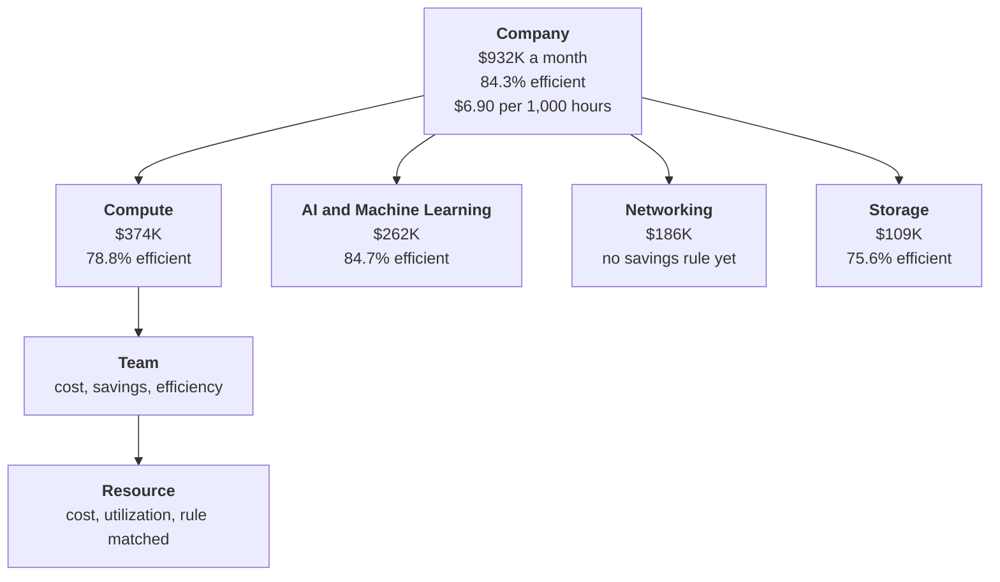
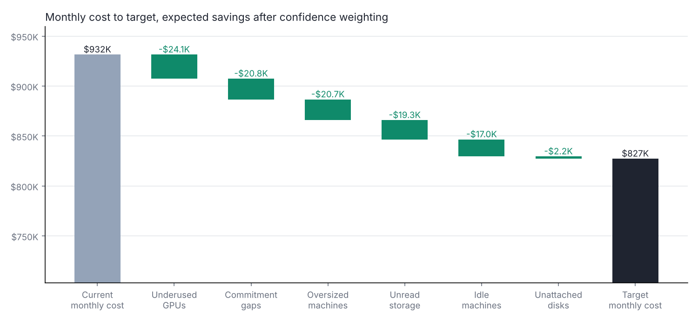
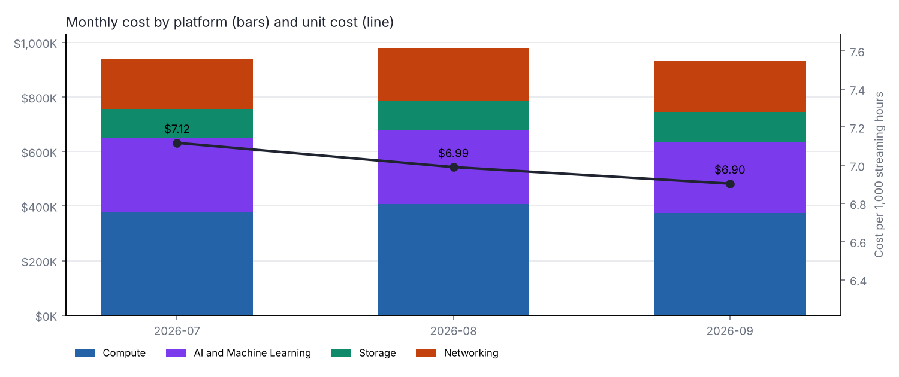
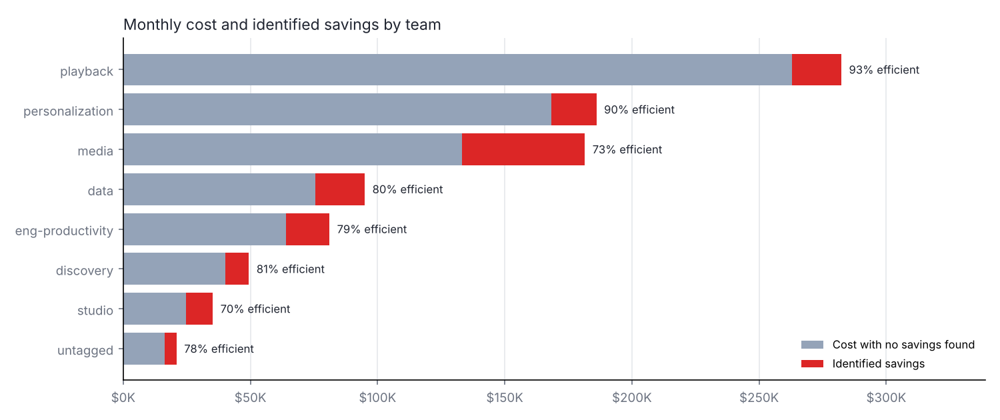
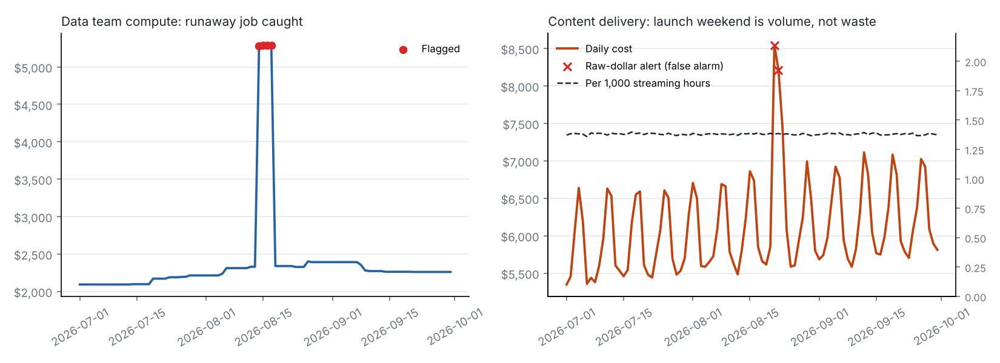

# Cloud Efficiency Metrics

[](../../actions/workflows/tests.yml)


**A metric framework for cloud and AI infrastructure spend.** It reads a cloud bill, checks that the numbers can be trusted, and reports cost, waste, unit cost and a savings target at every level from a single machine to the whole company. Every level adds up exactly to the one above it.

| | |
| --- | --- |
| **Monthly cost** | $931,558 across compute, GPUs, storage, delivery and AI tooling |
| **Savings found** | $146,236 a month across 351 resources, $104,184 of it expected to land |
| **Target** | $827,375 a month, with every dollar tied to a specific resource and team |
| **Unit cost** | $6.90 per 1,000 streaming hours, target $6.13 |
| **Detection** | 88% to 100% recall and 93% to 100% precision against problems planted in the data |
| **Data checks** | 9 of 9 passed, including an invoice match and a duplicated export day caught and removed |

**[Open the live dashboard](https://saialoor.github.io/cloud-efficiency-metrics/)** and drop in your own FOCUS bill, or explore the sample. It runs entirely in your browser, so a bill never leaves your computer.

> **About the data.** Real billing data is private, so this project runs on a simulated three-month bill for a fictional streaming company. It follows the FinOps FOCUS format, the open billing standard that the major cloud providers export, so a real bill can replace it without code changes. Problems were planted in the data on purpose, which makes it possible to measure how many the rules actually find.

## Contents

- [Why I built this](#why-i-built-this)
- [The metric tree](#the-metric-tree)
- [What the data shows](#what-the-data-shows)
- [The dashboard](#the-dashboard)
- [Latest results](#latest-results)
- [How savings are found and sized](#how-savings-are-found-and-sized)
- [Anomalies](#anomalies)
- [AI tooling: cost and productivity](#ai-tooling-cost-and-productivity)
- [Data checks](#data-checks)
- [Decisions and tradeoffs](#decisions-and-tradeoffs)
- [Run it](#run-it)
- [Limits and next steps](#limits-and-next-steps)

## Why I built this

Cloud cost reports usually answer "what did we spend?" and stop there. The questions that change decisions come next: how much of it is waste, which team owns it, what a realistic target is, and whether a jump in spend is a problem or just more business. They're hard to answer because the numbers rarely agree with each other. A team's dashboard says one thing, the finance total says another, and nobody trusts either.

I wanted to build the whole loop the way I'd want it to run at work. Check the data before using it. Define every metric so the levels add up. Size each saving and say how likely it is to happen. Measure how well the rules work instead of assuming they do.

## The metric tree

<!-- TREE:START -->

<!-- TREE:END -->

Two rules hold the tree together:

- **Dollar metrics are sums.** Cost and savings for every team add up exactly to the company total, and so do the platforms. `outputs/team_by_platform.csv` shows both directions in one table.
- **Ratio metrics are a ratio of sums.** Company efficiency is total savings divided by total cost, never an average of team percentages. Averaging would let a $35K team count as much as a $280K team, and the company number would stop matching its parts. Utilization is weighted by cost for the same reason.

The tests check both rules on every run.

| Metric | Definition | Reported at |
| --- | --- | --- |
| Cost | Amortized usage cost (FOCUS `EffectiveCost`), so a commitment purchase is spread over the days it covers | Every level |
| Identified savings | Monthly savings from the rules below, each resource counted once | Every level |
| Efficiency | 1 minus identified savings divided by cost | Every level |
| Rule coverage | Share of cost that at least one savings rule can inspect | Platform, company |
| Cost per 1,000 streaming hours | Cost divided by viewing hours, the main unit cost | Company, delivery |
| Cost-weighted utilization | CPU or GPU use, weighted by what each machine costs | Compute, GPUs |
| Commitment coverage | Share of production vCPU-hours on discounted commitments | Compute |
| Tag coverage | Share of cost with a team owner | Company |
| Cost per accepted AI output | AI tooling spend divided by the outputs people kept | Team, company |

Rule coverage sits next to efficiency on purpose. Content delivery would show as 100% efficient only because no rule checks it yet. The coverage number makes that read as "not checked" instead of "no waste."

## What the data shows

Findings for September 2026, the latest month.

1. **Five GPU nodes hold more savings than 86 oversized machines.** Underused GPUs account for $40,176 a month in identified savings, compared with $34,553 for right-sizing ordinary machines. GPU spend is concentrated, so a handful of nodes moves the total.
2. **One team holds a third of the savings.** Media is 19.5% of cost but 33% of identified savings ($48,189), mostly unread storage and oversized encoding machines. That's where a review would start.
3. **Compute runs at 37% cost-weighted CPU utilization.** That's common for fleets sized for peak load, and it's why right-sizing and commitments together make up three quarters of compute savings.
4. **Unit cost is falling.** Cost per 1,000 streaming hours went from $7.12 in July to $6.90 in September, a 3% drop, while viewing grew.
5. **A runaway job cost about $12,000 in four days.** The data team's backfill ran on 40 large machines from August 14 to 17, about $3,070 a day over normal. Daily anomaly detection flagged all four days.
6. **AI tooling value varies widely by team.** Engineering productivity keeps 52% of AI outputs at $0.061 each. Studio keeps 29% at $0.109 each, nearly twice the cost per useful output.
7. **2.3% of spend has no owner.** $20,962 a month carries no team tag. Coverage is above the 95% target, but those costs still can't be assigned to anyone.

## The dashboard

[saialoor.github.io/cloud-efficiency-metrics](https://saialoor.github.io/cloud-efficiency-metrics/) is a single web page that runs the same analysis on any FOCUS bill.

- **Drop in files.** Drag in a billing export and, optionally, utilization, inventory, business volume and invoice files. Each file is matched to its slot by its columns, so names don't matter.
- **Nothing is uploaded.** All the math runs in the browser. Companies won't send billing data to a stranger's website, so the tool is built so they never have to.
- **Works with what you have.** With only a bill, every data check except the invoice match still runs, and so does the commitment rule. Rules that need more data are listed as not run, and rule coverage drops to match, so the page never claims a resource was checked when it wasn't.
- **Everything is explorable.** The cost-to-target waterfall, platforms, teams, monthly trend, a daily chart for each flagged team, and a searchable, sortable table of every recommendation that downloads as CSV.
- **No dependencies.** One HTML file and one JavaScript file, including a small CSV reader, with no libraries to load.

The dashboard's engine (`docs/engine.js`) is a JavaScript version of the Python pipeline. A parity test runs both on the sample data and checks that every total, savings rule, team number and anomaly matches to the cent.

## Latest results

These tables and charts are rewritten every time the pipeline runs.

<!-- RESULTS:START -->
Window: **Sep 1 to Sep 30, 2026**. Data checks: **9 of 9 passed**. Unit cost moved from $7.12 in 2026-07 to $6.90 in 2026-09 per 1,000 streaming hours.

| Metric | Now | Target |
| --- | --- | --- |
| Monthly infrastructure cost | $931,558 | $827,375 |
| Cost per 1,000 streaming hours | $6.90 | $6.13 |
| Efficiency (1 - identified savings / cost) | 84.3% | 94.9% |
| Team tag coverage | 97.7% | 95.0% or higher |
| Cost covered by a savings rule | 79.2% | Add rules for delivery and AI tooling |



| Opportunity | Resources | Monthly savings | Confidence | Expected savings |
| --- | ---: | ---: | ---: | ---: |
| Consolidate underused GPUs | 5 | $40,176 | 60% | $24,106 |
| Cover steady usage with commitments | 184 | $26,006 | 80% | $20,805 |
| Right-size oversized machines | 86 | $34,553 | 60% | $20,732 |
| Move unread data to archive | 18 | $24,091 | 80% | $19,273 |
| Shut down idle machines | 44 | $18,939 | 90% | $17,045 |
| Delete unattached disks | 14 | $2,470 | 90% | $2,223 |

**By platform**

| Platform | Monthly cost | Identified savings | Efficiency | Rule coverage |
| --- | ---: | ---: | ---: | ---: |
| Compute | $374,176 | $79,498 | 78.8% | 100.0% |
| AI and Machine Learning | $262,208 | $40,176 | 84.7% | 97.0% |
| Networking | $186,251 | $0 | 100.0% | 0.0% |
| Storage | $108,924 | $26,561 | 75.6% | 100.0% |

**How well the rules find the planted problems**

| Problem | Planted | Flagged | Correct | Precision | Recall |
| --- | ---: | ---: | ---: | ---: | ---: |
| Shut down idle machines | 50 | 44 | 44 | 100.0% | 88.0% |
| Right-size oversized machines | 80 | 86 | 80 | 93.0% | 100.0% |
| Consolidate underused GPUs | 5 | 5 | 5 | 100.0% | 100.0% |
| Move unread data to archive | 18 | 18 | 18 | 100.0% | 100.0% |
| Delete unattached disks | 14 | 14 | 14 | 100.0% | 100.0% |






<!-- RESULTS:END -->

## How savings are found and sized

Each rule looks at the last 30 days. A resource goes to the first rule it matches, so no saving is counted twice.

| Rule | Flags a resource when | Action | Saving | Confidence |
| --- | --- | --- | --- | --- |
| Unattached disks | The disk isn't attached to anything | Snapshot, then delete | 100% of its cost | 90% |
| Idle machines | Average CPU under 5% and peak under 10% for 14 days | Shut down | 100% | 90% |
| Unread storage | Standard-tier data not read in 90 days | Move to archive tier | 83%, the price difference | 80% |
| Oversized machines | Peak CPU under 40% | Resize so the peak runs near 65% | Cost of the vCPUs removed | 60% |
| Underused GPUs | Average GPU use under 30% | Consolidate to reach 70% | Cost of the GPUs freed | 60% |
| Commitment gaps | Production machine on on-demand pricing, running all 30 days | 1-year commitment | 35% | 80% |

**Setting the target.** The target is today's cost minus each saving times its confidence. Confidence is how often that kind of fix actually lands. Deleting an unattached disk almost always happens. Resizing a machine often stalls because a team wants the headroom. A target built this way traces back to specific resources and owners, so a team can see exactly what it would take to hit it.

**Scoring the rules.** Because the problems were planted, every rule gets a precision and recall score. The misses are the kind that happen with real data:

- Six idle machines still run a weekly backup, so their peak CPU is too high to count as idle. The oversized rule catches them instead, with a smaller saving than shutting them down.
- Some production machines are failover standbys that sit at low load by design, so they look oversized. That's why the oversized rule has 60% confidence and its findings go to the owning team for review before anything changes.

## Anomalies

Each team's daily cost on each platform is compared with its previous 28 days using a robust z-score: the median and the median absolute deviation, so one bad day doesn't move the baseline. A day is flagged when it's at least 4 deviations from normal and at least $1,000 off.

Spend that follows business volume is checked per streaming hour instead of in raw dollars. On the August 21 launch weekend, delivery cost rose 47% in a day. Raw-dollar alerting flags that as a problem. Per streaming hour, it's flat, because it's just more people watching. The chart in the results shows both.

## AI tooling: cost and productivity

There's no settled way yet to measure what AI tools do for productivity. I break it into four links, from easiest to hardest to measure:

| Link | Question | Measured here |
| --- | --- | --- |
| Cost | What does each team spend? | Yes |
| Usage | How many people use it, and how often? | Yes |
| Quality | How often do people keep what it produces? | Yes, as acceptance rate |
| Outcome | Does work ship faster or better because of it? | No. This needs delivery data and a comparison group, such as a staged rollout |

Cost per accepted output combines the first three links. It's a useful early signal, but it isn't productivity: a team can accept many small suggestions that save little time. Measuring the outcome link takes a proper experiment, and that's the next step with real data.

<!-- AI:START -->
| Team | Monthly spend | Weekday users | Requests | Acceptance rate | Cost per accepted output |
| --- | ---: | ---: | ---: | ---: | ---: |
| eng-productivity | $2,370 | 78 | 75,226 | 52.0% | $0.061 |
| data | $1,676 | 64 | 53,191 | 44.3% | $0.071 |
| playback | $1,234 | 59 | 39,184 | 41.8% | $0.075 |
| personalization | $1,179 | 52 | 37,426 | 47.3% | $0.067 |
| media | $621 | 45 | 19,709 | 33.5% | $0.094 |
| discovery | $542 | 32 | 17,200 | 37.8% | $0.083 |
| studio | $225 | 26 | 7,142 | 29.0% | $0.109 |
<!-- AI:END -->

## Data checks

The pipeline stops before computing anything if a check fails.

| Check | What it catches |
| --- | --- |
| FOCUS columns present | An export in the wrong format |
| Duplicate line items | The same rows delivered twice. The simulated bill has 300 duplicated rows on September 12, which are removed and logged |
| Invoice match | Billed cost for each month must equal the invoice within $1 |
| Commitments fully amortized | Commitment purchases must equal the usage they cover, or cost is counted twice |
| Negative cost only on credits | Refunds or errors hiding inside usage |
| Charges inside their billing month | Late or misdated rows |
| Team tag coverage | Spend nobody owns (warning below 95%) |

## Decisions and tradeoffs

**Two cost columns, one for each purpose.** A FOCUS bill has `BilledCost`, which matches the invoice and charges a commitment up front, and `EffectiveCost`, which spreads it over the days it covers. Mixing them double counts every commitment. The pipeline reconciles each column to its own source and uses `EffectiveCost` for every metric.

**Confidence-weighted targets over raw savings.** Reporting the full $146K as the goal would set a target that can't be hit, and a missed target teaches people to ignore the next one. The expected $104K is smaller but defensible.

**First match wins.** A machine can be both oversized and on on-demand pricing. Counting both savings would overstate the total, so each resource is assigned to one rule, in order of how certain the fix is.

**Simple rules over a model.** Each rule is one sentence an engineer can check against their own dashboard. That matters more than a few points of accuracy when the goal is getting teams to act.

**One method, two languages, tested against each other.** The Python pipeline is the reference and runs the tests and reports. The browser version exists so anyone can use the tool without installing anything. Keeping two copies of the logic is a real risk, so the parity test fails the build if they ever disagree.

**Medians over averages for anomalies.** A mean and standard deviation baseline gets pulled up by the very spike it's trying to catch. The median version doesn't, which the tests confirm.

## Run it

```bash
pip install -r requirements.txt
python run.py              # uses data/ (creates the simulated data if it's missing)
python run.py --simulate   # regenerate the simulated data
pytest -q                  # 15 tests, including the Python and browser parity check
```

To run on a real bill, replace `data/billing_focus.csv.gz` with a FOCUS export and provide utilization data in the same shape as `data/telemetry.csv.gz`.

**Dashboard.** Turn on GitHub Pages from the `/docs` folder. `docs/index.html` is the interactive dashboard and `docs/report.html` is a static report of the sample results.

```
cloud-efficiency-metrics/
├── run.py                   runs everything
├── efficiency/
│   ├── simulate.py          simulated FOCUS bill, usage data and planted problems
│   ├── load.py              loading and data checks
│   ├── opportunities.py     savings rules, sizing, confidence and scoring
│   ├── metrics.py           metric tree, unit costs and AI tooling
│   ├── anomalies.py         daily anomaly detection
│   └── report.py            charts, README tables and dashboard
├── data/                    simulated inputs
├── outputs/                 result tables and charts
├── docs/
│   ├── index.html           interactive dashboard
│   ├── engine.js            browser version of the pipeline
│   ├── report.html          static report
│   └── sample/              sample bill the dashboard opens with
└── tests/                   15 tests, including Python and browser parity
```

## Limits and next steps

- **The data is simulated.** The rules and metrics are real; the dollar amounts are not.
- **Delivery and AI tooling have no savings rules yet.** Rule coverage shows 79% of cost covered. Next: cache efficiency for delivery, and model choice and prompt size for AI tooling.
- **Daily averages can hide short bursts.** A production version would use hourly data and check memory as well as CPU before recommending a smaller machine.
- **Confidence values are estimates.** With real history, each should be replaced by the share of past recommendations of that type that were actually carried out.
- **The AI outcome link isn't measured.** That needs delivery data and a comparison group.

## Author

**Sai Soumya Aloor**, financial data analyst  
saialoor@outlook.com

Licensed under the MIT License.
